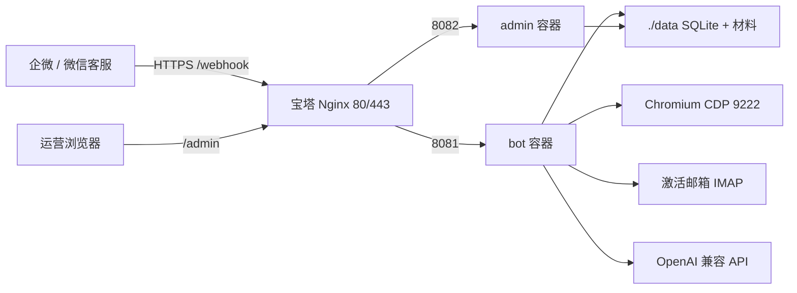

# finance-ai 交接文档

给开发和运维接手人的全景说明。读完应能独立部署、改代码、排障。专题细节链到现有手册，不在此重复粘贴。

| 角色 | 先读 | 再读 |
|------|------|------|
| 运维上线 | 第 1、5、6、9 节 | [DEPLOY_BAOTA.md](DEPLOY_BAOTA.md)、[deploy/DOCKER.md](../deploy/DOCKER.md)、[deploy/OPS.md](../deploy/OPS.md) |
| 开发改功能 | 第 1–4、8、10 节 | 对应分层目录 + `tests/` |
| 排 ICRIS / 浏览器 | 第 8 节 | [ICRIS_CDP_QUEUE.md](ICRIS_CDP_QUEUE.md) |

---

## 1. 项目是什么

香港公司注册自动化：**企微客户对接 → 材料识别 → ICRIS 开户/激活 → NNC1 填表**。

对客走企业微信（外部客户群和/或微信客服）；内部用管理后台看会话、任务、证件。浏览器自动打开香港公司注册处 ICRIS，注册账号并填 NNC1。

### 硬边界（不可破）

- **NNC1 停在初步检查，不进付款页。** 结果格出现「通过/通過」或「拒绝/拒絕」即停、落库、发审核群通知。禁止再点「继续/繼續」。
- 默认 `DRY_RUN=true` 且 `ICRIS_ALLOW_SUBMIT=false`。只有两者同时放开才会点 ICRIS **最终提交**。问答放量和真提交解耦：客服稳定前保持 dry-run。
- 注册与 NNC1 **共用** CDP Chrome 端口 `9222`，同时只能一方持锁。激活邮件走独立浏览器，不占 9222。
- Agent（`python main.py wework-external-bot`，8081）与 Admin（`python main.py admin`，8082）**分进程**。Worker / CDP 锁只在 **bot** 启用；admin 不要抢 9222。

### 生产入口

| 进程 | 命令 | 端口 | 职责 |
|------|------|------|------|
| bot | `python main.py wework-external-bot` | 8081 | 企微回调、微信客服、AI 回复、ICRIS Worker |
| admin | `python main.py admin` | 8082 | 管理后台 SPA + `/admin/api` |

Docker 同一镜像跑两个容器，共享宿主机 `./data`。

---

## 2. 架构与数据流



公网只开 80/443。8081、8082、9222、6333（Qdrant）均不对外。

### 对客到填表

1. 客户在微信客服或外部群发消息（建群欢迎、`/资料`、问答、传证件、键值材料）。
2. bot 验签回调 / kf 轮询 → 意图分流 → 材料聚合（证件 OCR/视觉、姓名地址分类）。
3. 材料齐全后客户回复「确认」→ 写入 `registration_jobs`（`pending`）。
4. **bot 内 Worker 串行**认领任务：
   - ICRIS 开户填表（s01–s03a）
   - s03a **人工审核**（浏览器保持打开、继续持锁；后台点通过/拒绝）
   - IMAP 读激活信，独立浏览器点链接（不占 9222）
   - NNC1 填表，停在**初步检查**
   - 审核群 markdown 通知（通过绿 `info`，拒绝橙红 `warning`）
5. 运营在 `/admin` 看任务、截图、重跑注册或重跑填表。

Mock「确认」（`wework-external-mock --text "确认"`）只入队，**不会**自己跑 ICRIS。必须有 `wework-external-bot` 在跑才会认领。`python main.py --step register` **不走队列**，不能用来验调度。

### 会话状态（`external_groups.status`）

`INIT` → `WELCOMED` → `QA` / `COLLECTING` → `REVIEW` → `CONFIRMED` / `QUEUED`。另有 `HANDOFF`、`FAILED`（可「重新办理」）、`HUMAN`（转人工，不封锁问答）。

### 注册任务状态

| 字段 | 典型值 | 含义 |
|------|--------|------|
| `status` | `pending` / `running` / `awaiting_review` / `succeeded` / `failed` | 开户阶段 |
| `review_status` | `awaiting_review` / `approved` / `rejected` | s03a 人工审核 |
| `activation_status` | `pending` / `activated` 等 | 邮件激活 |
| `form_status` | `pending` / `filled` / `failed` | NNC1 填表 |

后台「重跑」改注册 `status`；「重跑填表」只把 `form_status` 改回待填表，不立刻开浏览器。两者不要混用。

---

## 3. 仓库分层

改哪一层就留在哪一层，不要为了「顺便」跨层大改。

| 路径 | 职责 |
|------|------|
| `src/wework/` | 企微客服、群状态机、意图、任务 Worker、审核群通知 |
| `src/materials/` | 证件/姓名/地址识别与聚合 |
| `src/browser/` | Playwright/CDP 登录、注册、NNC1、验证码 |
| `src/storage/` | SQLite（库在 `data/`，勿提交 git） |
| `src/web/` + `web/admin/` | 管理后台 API（8082）与 React SPA |
| `src/agent/` + `src/rag/` | QA Agent、知识检索 |
| `config/settings.py` | 配置入口；**密钥只来自 `.env`** |
| `main.py` | CLI：生产 bot/admin，以及本地步骤/RAG 调试 |
| `deploy/` | Docker、Nginx 样例、备份、运维手册 |
| `docs/knowledge/` | RAG 主知识（`注册.md`） |
| `tests/` | `unittest` |

### `main.py` 常用命令

| 命令 | 用途 |
|------|------|
| `python main.py wework-external-bot` | **生产 Agent**（回调 + KF + ICRIS Worker） |
| `python main.py admin` | **生产管理后台** |
| `python main.py rag-ingest` | 知识入库 |
| `python main.py rag-status` / `rag-query` / `agent-query` | RAG / QA 调试 |
| `python main.py wework-external-mock` / `wework-kf-mock` | 本地模拟客户消息 |
| `python main.py --step register` / `--step nnc1` | 本机单步浏览器（**不走队列**） |
| `python main.py steps` | 列出旧工作流步骤 |

过时入口：不要用旧的 `wework-bot` 当生产客服。飞书 `feishu-bot` 非本交接主路径。

---

## 4. 本地开发

环境：Python 3.12、Node 20（仅改后台前端时需要）、本机 Chrome/Edge 或 Playwright Chromium。

```powershell
cd D:\projects\finance-ai
python -m venv .venv
.\.venv\Scripts\Activate.ps1
pip install -r requirements.txt
playwright install chromium
copy .env.example .env
# 编辑 .env：至少 OPENAI_API_KEY；本机填表设 BROWSER_HEADLESS=false
```

本机跑客服 + 后台（两个终端）：

```powershell
python main.py wework-external-bot
# 另开终端：先构建前端（首次或改了 web/admin 之后）
cd web/admin && npm install && npm run build && cd ../..
python main.py admin
```

- Agent 探活：http://127.0.0.1:8081/health
- 后台：http://127.0.0.1:8082/admin （`ADMIN_USERNAME` / `ADMIN_PASSWORD`）
- 前端热更新：`cd web/admin && npm run dev`（默认 http://127.0.0.1:5173/admin/ ，需 admin 进程已起）

本机 ICRIS 调试：`BROWSER_HEADLESS=false`，不要用 Docker 那套 `CHROME_USE_EXISTING=false` 硬套本地窗口。验证码建议配 `TWOCAPTCHA_API_KEY`，或 `CAPTCHA_MODE=manual` 自己看图输入。

测试：

```powershell
python -m unittest discover -s tests -v
# 调度/CDP 回归（不打真实 ICRIS）：
python -m unittest tests.test_job_scheduler_e2e tests.test_cdp_queue -v
```

改判定、群通知、NNC1 初步检查时，必须同步改对应测试。

---

## 5. 生产：机器与部署

### 买什么机器

| 项 | 最低 | 建议 |
|----|------|------|
| CPU | 2 核 | 2 核；经常填 ICRIS 可 4 核 |
| 内存 | 4 GB | **8 GB**（bot + admin + Chromium） |
| 磁盘 | 40 GB SSD | 60–80 GB |
| 架构 | x86_64 / amd64 | **不要 ARM**（Chrome 装不上） |
| 系统 | Linux | Ubuntu 22.04 / Debian 12，或宝塔 |
| 公网 | 要有公网 IP + 域名 | 企微回调必须 HTTPS |

不要买 2G 内存机。只做客服可用大陆机；**要自动开 ICRIS 必须香港/海外出口**（大陆 IP 会被 F5 TSbd 空页，Vue 不挂载）。

### 推荐路径：宝塔 + Docker

完整步骤：[DEPLOY_BAOTA.md](DEPLOY_BAOTA.md)、[deploy/DOCKER.md](../deploy/DOCKER.md)。更新代码：[deploy/OPS.md](../deploy/OPS.md)。

```bash
cd /www/wwwroot/finance-ai   # 按实际路径
cp .env.example .env         # 填第 6 节必填项
mkdir -p data/materials
docker compose up -d --build
# 可选 RAG：
# docker compose --profile rag up -d --build
# docker compose exec bot python main.py rag-ingest
```

compose 已设 `shm_size: "2gb"`（Chromium 需要）。宝塔「编排」UI 若不识别，用终端执行上面的命令。

反代（目标必须 `127.0.0.1`，路径末尾不要多 `/`）：

| 路径 | 目标 | 用途 |
|------|------|------|
| `/webhook` | `http://127.0.0.1:8081` | 企微回调（生产 URL） |
| `/wework/external/callback` | 同上 | 备用回调路径 |
| `/health` | 同上 | 探活 |
| `/admin` | `http://127.0.0.1:8082` | 管理后台（建议 IP 白名单） |

企微后台「接收消息」和「客户联系 → 接收事件」均填：`https://你的域名/webhook`。Token / EncodingAESKey 与 `.env` 完全一致。勾选客户群变更 `change_external_chat`。SSL 用 Let's Encrypt，强制 HTTPS（企微不认自签名）。

防火墙 / 安全组只放行 **80、443**。

日常更新：

```bash
cd /www/wwwroot/finance-ai
bash deploy/backup-db.sh
git pull
docker compose up -d --build
curl -fsS http://127.0.0.1:8081/health
curl -fsS http://127.0.0.1:8082/health
```

只改 `.env` 不必 `--build`：`docker compose up -d`（异常则 `--force-recreate`）。改了 `web/admin` **必须** `--build`，浏览器对 `/admin/` 做一次 Ctrl+F5。

---

## 6. 环境变量

复制模板：`.env.example` 或 `deploy/env.docker.example`。`.env` 留在服务器，**不要提交 Git，不要打进镜像**。

Docker 下 compose 会覆盖：`BROWSER_HEADLESS=true`、`CHROME_USE_EXISTING=false`（容器内 Playwright Chromium，不要连宿主机 Chrome）、bot 的 `WEWORK_EXTERNAL_CALLBACK_PORT=8081`、admin 的 `ICRIS_WORKER_ENABLED=false`。

### 必填

| 变量 | 说明 |
|------|------|
| `OPENAI_API_KEY` | LLM；证件看图建议再填 `OPENAI_VISION_MODEL` |
| `OPENAI_API_BASE` | 默认 `https://ai-yyds.com/v1` |
| `OPENAI_MODEL` | 如 `gpt-4o-mini` |
| `WEWORK_CORP_ID` | 企业 ID |
| `WEWORK_CORP_SECRET` | **自建应用** Secret，不能填客服 Secret |
| `WEWORK_AGENT_ID` | 同一自建应用 |
| `WEWORK_EXTERNAL_CALLBACK_TOKEN` | 与企微后台 Token 一致 |
| `WEWORK_EXTERNAL_CALLBACK_AES_KEY` | 与企微 EncodingAESKey 一致 |
| `WEWORK_KF_SECRET` | 微信客服 Secret（后台「微信客服」里拿） |
| `WEWORK_KF_OPEN_KFID` | 或 JSON `WEWORK_KF_ACCOUNTS` |
| `ADMIN_PASSWORD` | 空则无法登录 `/admin` |
| `ADMIN_USERNAME` | 默认 `admin` |
| `DRY_RUN` | 生产先 `true` |
| `ICRIS_ALLOW_SUBMIT` | 生产先 `false` |

### 强烈建议（要跑 ICRIS 填表）

| 变量 | 说明 |
|------|------|
| `TWOCAPTCHA_API_KEY` | ICRIS 5 位彩色 GIF；`CAPTCHA_MODE=2captcha` 或 `auto` |
| `EMAIL_IMAP_HOST` / `PORT` / `ADDRESS` / `PASSWORD` | 读激活信；也可在后台「邮箱配置」维护多账号 |
| `ICRIS_REVIEW_WEBHOOK_URL` 或 `ICRIS_REVIEW_NOTIFY_CHAT_ID` | s03a / 初步检查审核群 |
| `ADMIN_PUBLIC_URL` | 如 `https://你的域名/admin`，通知里拼任务链接 |
| `WEWORK_DEFAULT_GROUP_OWNER_USERID` | 转人工通知专员（企业成员 userid） |
| `MATERIALS_DEFAULT_CONTACT_EMAIL` / `PHONE` | 客户未填联络时回填 |

### 按需

| 用途 | 变量 / 动作 |
|------|-------------|
| 通道 | `WEWORK_CHANNEL=kf` 或 `both`；`WEWORK_KF_MODE=both` |
| RAG 向量 | compose `--profile rag`，`QDRANT_URL=http://qdrant:6333`，`RAG_ENABLED=true` |
| 熔断 | `WEWORK_AGENT_MODE=normal` / `shadow` / `disabled` |
| 住址翻译按钮 | Google / 有道 / DeepL 任一 key |
| 会话存档 | Linux `libWeWorkFinanceSdk.so` + `WEWORK_ARCHIVE_*`（Windows `.dll` 不能进 Linux 容器） |

`BROWSER_PROXY` 曾出现在部署 FAQ 中，**尚未接入** `config/settings.py`。代码默认 `BROWSER_NO_PROXY=true`。要出海需在宿主机/容器网络层走香港代理，不是只加一行环境变量。

完整键名见 `.env.example`。上线推荐值见 [PRODUCTION_CHECKLIST.md](PRODUCTION_CHECKLIST.md)。

---

## 7. 管理后台

地址：`https://你的域名/admin` 或本机 `http://127.0.0.1:8082/admin`。Cookie 会话，默认 12 小时。不要把 `/admin` 裸暴露公网。

| 菜单 | 路径 | 做什么 |
|------|------|--------|
| 运营统计 | `/admin/` | KPI、容器/健康、近 24h 问答与注册成败 |
| 注册任务 | `/admin/jobs` | 列表、取消 pending、重跑失败注册、`form_status=failed` 时「重跑填表」 |
| 任务详情 | `/admin/jobs/:id` | 步骤日志、截图、s03a 提交/拒绝 |
| 证件识别 | `/admin/id-extract` | 上传证件，类型/号码/姓名地址 |
| 快速注册 | `/admin/register` | 运营代填资料入队，不经过客户群确认 |
| 外部群发消息 | `/admin/wework-send` | 向外部群发测试消息 |
| 邮箱配置 | `/admin/email-config` | ICRIS 激活 IMAP 账号 |
| 注册配置 | `/admin/default-office` | 默认注册地址等 |

路由还在、侧栏可能隐藏：会话材料 `/admin/sessions`、回答质量 `/admin/quality`。改 UI/路由/状态后按真实用户路径点一遍，不要只看截图。

---

## 8. ICRIS 与 CDP（最容易踩坑）

细则：[ICRIS_CDP_QUEUE.md](ICRIS_CDP_QUEUE.md)。实现：`src/browser/cdp_lock.py`、`cdp_session.py`；Worker：`src/wework/icris_job_worker.py`、`icris_activation_worker.py`。

### 谁占用 9222

| 阶段 | 浏览器 | 锁 |
|------|--------|----|
| 注册 s01–s03a | CDP Chrome 9222 | 持锁 |
| 人工审核 `awaiting_review` | 同一会话保持打开 | 继续持锁 |
| 激活（点邮件链接） | 独立 Chrome | 不持锁 |
| NNC1 填表 | CDP Chrome 9222 | 持锁；有注册排队则让路 |

锁文件在 `data/`：`icris-cdp.lock`、`icris-cdp.lease.json`。心跳约 10 秒；约 90 秒过期。pid 已死则立刻清锁，不必空等。

### 排队

- 注册 FIFO（`id ASC`），最多 3 次（`ICRIS_JOB_MAX_ATTEMPTS`，含首次）。
- NNC1 **不自动重试**。
- 存在 running / `awaiting_review` / 已到期 pending 注册时，不启动填表。退避中的 `available_at` **不挡**填表。
- 健康进行中的 NNC1：新注册等待，不要中途杀 Chrome。
- 看门狗默认 1500 秒（不含审核等待）；超时截图到 `data/icris_failures/watchdog_*.png` 后结束 CDP 并放锁。

### NNC1 初步检查

只认结果格「初步檢查結果 / 初步检查结果」：

- 通过：含 `通过` / `通過`，且不是「不通过/拒絕/Rejection」
- 拒绝：含 `拒绝` / `拒絕` / `不通过` / `Rejection`
- 格已明确通过时，**忽略**刮到的拒绝原因；格为空才用原因兜底失败

通过后落库、发群通知，**禁止点继续进付款**。页面文案简繁都认。

### 验证码

ICRIS 为 5 位彩色 GIF。生产优先 2Captcha（`src/browser/captcha_api.py` 多变体），失败可 OCR。预处理标签必须用循环变量 `threshold`（历史上 `f"{prefix}_bw{t}"` 会 `name 't' is not defined`，已修）。

### 大陆 IP

注册页 URL 能开但 body 空、`Vue未挂载`：TSbd 拦大陆出口，与 stealth 无关。换香港/海外机器，或在网络层给出海代理。

---

## 9. 日常运维与故障

### 日志与探活

```bash
docker compose logs -f bot
docker compose logs -f admin
docker compose logs --tail=200 bot
curl -fsS http://127.0.0.1:8081/health
curl -fsS http://127.0.0.1:8082/health
```

服务器上 curl 自己的公网域名常失败（`000`），用本机 `127.0.0.1` 或自己电脑浏览器测。

### 数据

- SQLite：`data/wework_external.db`；材料：`data/materials/`
- `docker compose down` **不会**删 `./data`；不要 `down -v`
- 部署前：`bash deploy/backup-db.sh`，只拷 `.db` 到仓库外 `../finance-ai-db-backups/`
- 权限异常：`chown -R 1000:1000 data/`

### 常见故障

| 现象 | 先查 |
|------|------|
| bot 健康检查失败 / 回调 503 | `.env` 缺 `WEWORK_CORP_ID` 或 Token/AES 与企微不一致；URL 必须是 `/webhook`；证书有效 |
| admin 登录 401 | `ADMIN_PASSWORD` 为空；改完 `docker compose restart admin` |
| `/admin` 重定向死循环 | 反代 `proxy_pass` 末尾多了 `/` |
| 任务列表步骤日志变成 `[object Object]` | 前端旧缓存；`--build` 后 Ctrl+F5 |
| 内存 OOM | 机器小于 4G；加 swap 或升配 8G |
| `Vue未挂载 bodyLen=0` | 大陆 IP；换香港出口 |
| Chrome 构建失败 `dl.google.com` | 大陆拉 Google 源失败；镜像已尽力安装，失败则用 Playwright Chromium |
| 图片预处理 `name 't' is not defined` | 旧代码 bug，当前 `captcha_api.py` 应使用 `{threshold}` |
| 两任务互相杀浏览器 | admin 误开 Worker，或两台 bot 抢 9222；确认只有 bot 容器 `ICRIS_WORKER_ENABLED=true` |
| 数据丢失 | 是否 `down -v`；是否把 `data/` 提交后又被覆盖 |

企微配置步骤：[WEWORK_EXTERNAL_GROUP_SETUP.md](WEWORK_EXTERNAL_GROUP_SETUP.md)。上线检查清单：[PRODUCTION_CHECKLIST.md](PRODUCTION_CHECKLIST.md)。

---

## 10. 改动纪律

- 只改任务相关文件；不主动 commit / push（除非明确要求）。
- **不要提交** `.env`、证件图、`data/*.db`、截图、`static/admin/` 构建产物。
- 注释与用户可见文案用中文；测试用 `unittest`（`tests/`）。
- 改初步检查判定或审核群通知时，同步改测试（见 `.cursor/rules/nnc1-prelim-check.mdc`、`wework-prelim-notify.mdc`）。
- 改 `web/admin` 的 UI/路由/状态后，按真实用户路径验证，不要只看截图。
- 密钥轮换：若日志或 git 泄露过 Secret，到企微后台与 LLM 控制台轮换。

```python
# 错误：填表成功后继续点「继续」进付款
await page.get_by_text("繼續").click()

# 正确：初步检查出结果即停、落库、发群通知
self.persist_form_outcome(True)
self.notify_prelim_result(passed=True, screenshot_path=shot)
```

---

## 附录：文档索引

| 文档 | 内容 |
|------|------|
| [DEPLOY_BAOTA.md](DEPLOY_BAOTA.md) | 宝塔 Docker 首次部署 |
| [deploy/DOCKER.md](../deploy/DOCKER.md) | Compose、反代、数据卷 |
| [deploy/OPS.md](../deploy/OPS.md) | 代码更新后怎么重新上线 |
| [PRODUCTION_CHECKLIST.md](PRODUCTION_CHECKLIST.md) | 生产清单、推荐 `.env`、放量 |
| [WEWORK_EXTERNAL_GROUP_SETUP.md](WEWORK_EXTERNAL_GROUP_SETUP.md) | 企微应用 / 客服 / 回调 |
| [EXTERNAL_GROUP_VERIFICATION.md](EXTERNAL_GROUP_VERIFICATION.md) | 群/KF Mock 验证命令 |
| [ICRIS_CDP_QUEUE.md](ICRIS_CDP_QUEUE.md) | 9222 锁、排队、看门狗 |
| [docs/knowledge/README.md](knowledge/README.md) | RAG 知识入库 |
| [docs/product/ai注册_bot_guide.md](product/ai注册_bot_guide.md) | 对客群指令说明 |
| [web/admin/README.md](../web/admin/README.md) | 后台前端开发 |
| `.env.example` | 全部环境变量注释 |

本文件不写现网密码、API Key、企微 Secret。密钥只存在服务器 `.env` 与对应云控制台。
